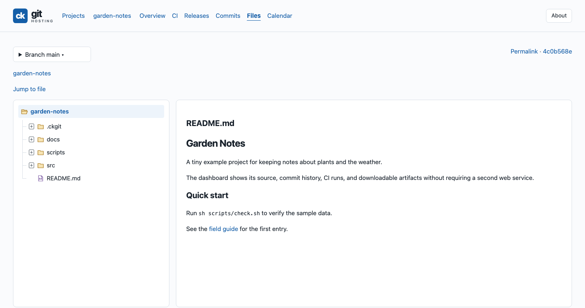

# ck-git-hosting

**Private Git hosting, multi-platform native CI/CD, and static documentation for your own server — in pure C++20, with no database, no containers, and no Node/Python runtime chain.**

`ck-git-hosting` sits between bare-bones Git tools (`cgit`, `gitolite`) and heavyweight web forges (`GitLab`, `Gitea`). It turns a modest Linux machine such as a Raspberry Pi into a complete Git control plane over OpenSSH: multi-device checkout synchronization (`ckgit`), a zero-JS read-only web dashboard (`ck-git-hostingd`), pull-based sandboxed CI runners across Linux, Windows, and macOS (`ck-ci-runnerd`), durable release archives, and a single-binary static documentation generator and Pages server (`ckdocs` + `ck-pagesd`).

[Install the server](docs/operations/01-installation.md) ·
[Set up a device](docs/guides/client-setup.md) ·
[Install CI runners](docs/operations/runner-setup.md) ·
[Explore the dashboard](docs/operations/08-web-dashboard.md) ·
[Get started with ckdocs](docs/operations/07-docs-sites.md)



## Why `ck-git-hosting`?

- **Plain Git on disk, zero database**: Repositories are standard bare Git directories alongside small, atomically written `.ini` records. If every daemon is stopped, `git clone` and `git push` over OpenSSH still work, and [backups](docs/operations/03-backup-and-recovery.md) are self-verifying file trees with SHA-256 manifests.
- **Multi-device checkout awareness**: Standard Git hosts only know what was pushed. [`ckgit`](docs/guides/publish-and-sync.md) tracks where your working copies live across your laptop, workstation, and SBCs (`ckgit scan`, `ckgit status`, `ckgit sync`), surfaces uncommitted or unpushed work across devices, and syncs branches and tags without accidental force-pushes.
- **Pull-only native CI across Linux, Windows, and macOS**: [Distributed runners](docs/operations/ci-remote-runners.md) pull jobs over restricted SSH forced commands with **zero listening ports on runner machines**. Builds run offline by default inside native OS sandboxes (Linux namespaces + cgroups, [Windows LPAC & Hyper-V HCS VMs](docs/operations/runner-windows.md), and [macOS Seatbelt](docs/operations/runner-macos-native.md)), stream live logs to the server, and automatically requeue if a portable runner sleeps or disconnects.
- **One-binary documentation & Pages (`ckdocs`)**: [`ckdocs`](docs/operations/07-docs-sites.md) compiles repository Markdown, GFM alerts, 73 syntax-highlighted languages, TeX math, and 23 Mermaid/XY diagram types into a fast 3-column searchable static site — with no Node.js, Python, or plugin bit-rot.
- **Hardened read-only web dashboard**: [`ck-git-hostingd`](docs/operations/08-web-dashboard.md) serves file trees, rendered READMEs, commit graphs, activity calendars, unified and side-by-side (`?diff=split`) commit diffs, live CI logs, and [release downloads](docs/operations/releases.md) using server-rendered HTML/CSS under a strict `Content-Security-Policy` (`default-src 'none'`). All mutations stay behind OpenSSH keys.
- **Deliberate scope**: Designed for solo developers, embedded/systems engineers, and high-trust teams on a LAN or VPN. By omitting web login accounts, issue trackers, and pull-request web forums, it runs effortlessly on a Raspberry Pi with near-zero maintenance.

## Start with a project

After [installing and pairing your device](docs/guides/client-setup.md):

```sh
ckgit setup --server ckgit@server --client-id laptop --web-host server
ckgit doctor
cd ~/code/my-project
ckgit publish
ckgit web
```

Replace `server` with your SSH host and `laptop` with your paired device ID.
`publish` previews the changes and asks for confirmation.

## What would you like to do?

| Task | Guide |
|---|---|
| Bring projects to your server | [Publish and sync](docs/guides/publish-and-sync.md) |
| Work from another device | [Clone and update](docs/guides/clone-and-update.md) |
| Choose or repair a local checkout | [Manage checkouts](docs/guides/manage-checkouts.md) |
| Browse files, commits, and build results | [Dashboard tour](docs/operations/08-web-dashboard.md) |
| Run automated builds | [Continuous integration](docs/operations/04-ci-cd.md) |
| Install and connect Linux, Windows, or macOS CI runners | [Runner installation](docs/operations/runner-setup.md) · [Windows runner](docs/operations/runner-windows.md) · [macOS runner](docs/operations/runner-macos-native.md) |
| Follow builds and get release packages | [Builds and releases](docs/guides/ci-and-releases.md) |
| Publish documentation and Mermaid diagrams | [Get started with ckdocs](docs/operations/07-docs-sites.md) |
| Protect or recover your repositories | [Backup and recovery](docs/operations/03-backup-and-recovery.md) |

## Reference and administration

- [Client commands](docs/reference/commands.md)
- [Server installation and upgrades](docs/operations/01-installation.md)
- [Packages and releases](docs/operations/02-packages-and-releases.md)
- [Build from source](docs/reference/build-and-test.md)
- [SSH and control protocol](docs/protocol/01-ssh-and-control-v1.md)

[Read the online documentation](https://cklukas.github.io/ck-git-hosting/).
Licensed under the [MIT License](LICENSE).
