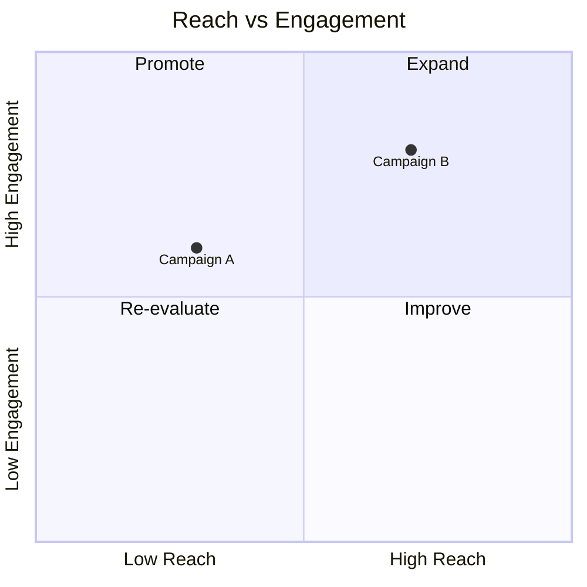

# Quadrant chart

[All diagram examples](../mermaid.md#diagram-examples)


Point labels automatically try eight nearby positions to reduce collisions with
other labels, markers, quadrant headings, and dividing lines. Coordinates, text,
and font sizes stay unchanged. The search is deterministic and bounded; dense
clusters and very long labels can still overlap. A larger chart or shorter
labels can help when there is insufficient room.


**Source**

````markdown

````

**Diagram**


Quadrant headings can move between inset edge positions within their own
quadrant when they cover points. Marker visibility takes priority over separating
text labels; no points are moved to make room.
