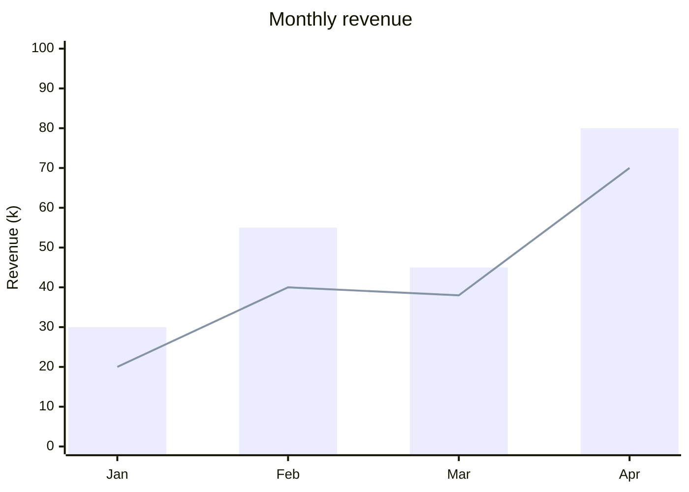

# XY chart

[All diagram examples](../mermaid.md#diagram-examples)


Crowded x-axis labels rotate automatically. The renderer reserves space for
their measured height and horizontal overhang, so ordinary first and last labels
remain within the chart. Extra margins are limited to preserve useful plot space;
very long or numerous labels may still need a larger chart or horizontal bars.
Labels are not truncated by the renderer. If a name is already shortened in the
Mermaid source, change the source generator to restore the full name.

Every `bar` and `line` statement is a series of its own, and
`xychart-beta horizontal` turns the chart on its side.
[XY charts in depth](../xy-charts.md) shows both.


**Source**

````markdown

````

**Diagram**


