```mermaid
xychart-beta horizontal
    title "Quarterly revenue"
    x-axis "Quarter" [Q1, Q2, Q3, Q4]
    y-axis "Revenue (k)" 0 --> 100
    bar [40, 55, 60, 80]
    bar [35, 60, 52, 85]
    line [30, 45, 50, 70]
```

# XY charts in depth

The [XY chart example](diagrams/xy-chart.md) shows the basic form. This page
covers several series, the horizontal form and error bars. The first two are
standard Mermaid; the `error` line is an extension of the CWorks renderer that
ckdocs embeds.

## Several series

Every `bar` and every `line` statement is a series of its own, drawn in the
order it is written. Bar series stand side by side within each category,
lines are drawn over them, and each series takes the next theme colour. A
series may carry a title before its values (`bar "Plan" [...]`); like
Mermaid, ckdocs draws no legend, so say what the colours mean in the text.

Each series needs exactly one value per category. A list that is shorter or
longer is reported with its line number instead of being drawn against the
wrong categories. Bars on a numeric x axis (`x-axis 0 --> 10`) stand at their
data positions, so only one bar series fits there; give the chart categories
for grouped or horizontal bars.

**Source**

````markdown

````

**Diagram**


```mermaid
xychart-beta
    title "Quarterly revenue"
    x-axis "Quarter" [Q1, Q2, Q3, Q4]
    y-axis "Revenue (k)" 0 --> 100
    bar "Plan" [40, 55, 60, 80]
    bar "Actual" [35, 60, 52, 85]
    line [30, 45, 50, 70]
```

## Horizontal charts

`xychart-beta horizontal` turns the chart on its side: the categories run
down the y axis, the first at the top, and the values along x. `x-axis` still
names the categories and `y-axis` the values, as in Mermaid. The front-matter
form `config: xyChart: chartOrientation: horizontal` is equivalent; the first
line wins when both are given.

**Source**

````markdown

````

**Diagram**


## Error bars (an extension of Mermaid)

Repeated measurements are reported as a value and its spread, such as a mean
and its standard deviation. An `error` line directly below a `bar` or `line`
statement gives that series error amounts, drawn as whiskers with caps along
the value axis.

One list gives symmetric amounts. Two lists give the amount below each value,
then the amount above it: `error [0.5] [0.9]` on a value of 2 reaches from 1.5
to 2.9. An amount is a distance from the value, a finite number of zero or
more. An empty entry, as in `error [1.4, , 0.8]`, draws no whisker at that
point. Comments may stand between a series and its error line; no other
statement may. A line's whiskers take its colour, a bar's take the axis colour
so that the half crossing the bar stays visible.

ckdocs reports the error line with its line number when it comes before any
series or after another statement, when a series already has one, when a list
has a different number of entries than the series has values, and when an
amount is negative or not a number. Bars on a numeric x axis take no error
amounts.

> [!NOTE]
> Standard Mermaid has no error-bar statement. `error` comes from the CWorks
> renderer that ckdocs embeds; Mermaid's own renderers, including the ones
> forges use to preview Markdown, reject a diagram that contains it. Removing
> the `error` lines leaves a diagram every Mermaid renderer draws.

**Source**

````markdown
```mermaid
xychart-beta
    title "Runs per configuration (mean, SD)"
    x-axis [a, b, c, d]
    y-axis "Score" 0 --> 6
    bar [3, 2.5, 4, 3.2]
    error [1.4, 0.3, 0.8, ]
    bar [2.4, 3.1, 3.6, 2.2]
    error [0.2, 0.6, 0.4, 0.5] [0.6, 0.9, 0.4, 1.1]
    line [2, 2.2, 3, 2.6]
    error [0.5, 0.5, 0.2, 0.3] [0.9, 0.4, 0.2, 0.3]
```
````

**Diagram**

```mermaid
xychart-beta
    title "Runs per configuration (mean, SD)"
    x-axis [a, b, c, d]
    y-axis "Score" 0 --> 6
    bar [3, 2.5, 4, 3.2]
    error [1.4, 0.3, 0.8, ]
    bar [2.4, 3.1, 3.6, 2.2]
    error [0.2, 0.6, 0.4, 0.5] [0.6, 0.9, 0.4, 1.1]
    line [2, 2.2, 3, 2.6]
    error [0.5, 0.5, 0.2, 0.3] [0.9, 0.4, 0.2, 0.3]
```
