```mermaid
xychart-beta horizontal
    title "Quarterly revenue"
    x-axis "Quarter" [Q1, Q2, Q3, Q4]
    y-axis "Revenue (k)" 0 --> 100
    bar [40, 55, 60, 80]
    bar [35, 60, 52, 85]
    line [30, 45, 50, 70]
```

# XY charts in depth

The [XY chart example](diagrams/xy-chart.md) shows the basic form. This page
covers several series and the horizontal form, both standard Mermaid.

## Several series

Every `bar` and every `line` statement is a series of its own, drawn in the
order it is written. Bar series stand side by side within each category,
lines are drawn over them, and each series takes the next theme colour. A
series may carry a title before its values (`bar "Plan" [...]`); like
Mermaid, ckdocs draws no legend, so say what the colours mean in the text.

Each series needs exactly one value per category. A list that is shorter or
longer is reported with its line number instead of being drawn against the
wrong categories. Bars on a numeric x axis (`x-axis 0 --> 10`) stand at their
data positions, so only one bar series fits there; give the chart categories
for grouped or horizontal bars.

**Source**

````markdown

````

**Diagram**


```mermaid
xychart-beta
    title "Quarterly revenue"
    x-axis "Quarter" [Q1, Q2, Q3, Q4]
    y-axis "Revenue (k)" 0 --> 100
    bar "Plan" [40, 55, 60, 80]
    bar "Actual" [35, 60, 52, 85]
    line [30, 45, 50, 70]
```

## Horizontal charts

`xychart-beta horizontal` turns the chart on its side: the categories run
down the y axis, the first at the top, and the values along x. `x-axis` still
names the categories and `y-axis` the values, as in Mermaid. The front-matter
form `config: xyChart: chartOrientation: horizontal` is equivalent; the first
line wins when both are given.

**Source**

````markdown

````

**Diagram**


