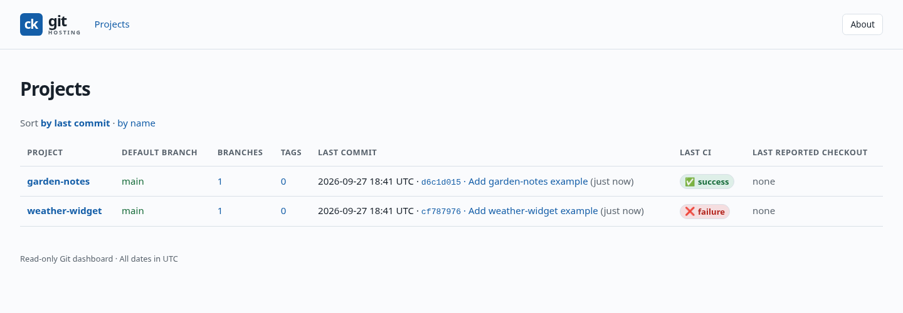
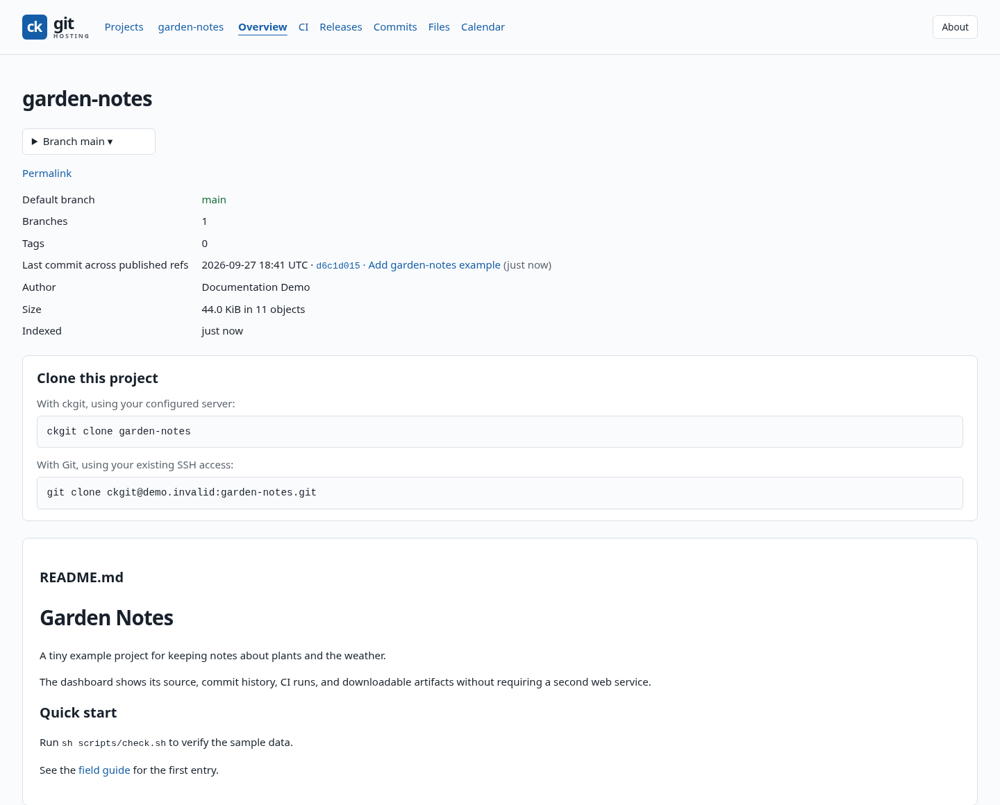
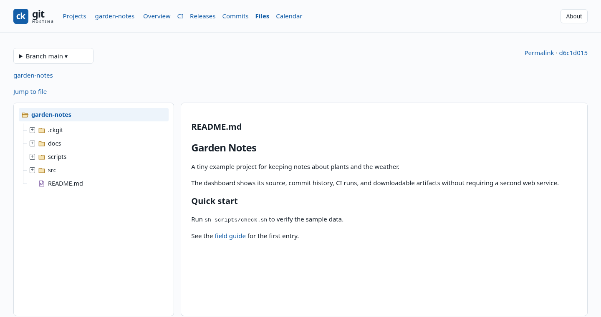
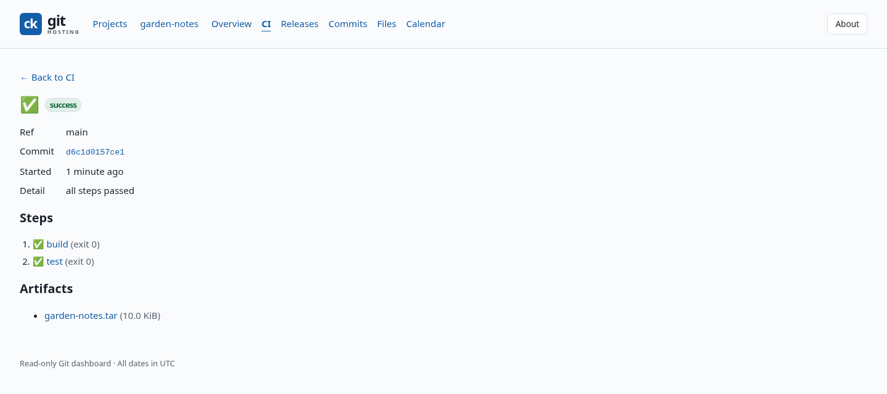

# Web dashboard tour

The dashboard is a small web view of the Git repositories hosted by
ck-git-hosting. It shows project activity, source files, commit history, and
continuous integration without a separate database or web application.

Run `ckgit web` to open it through an SSH tunnel. From inside a published
checkout, `ckgit open` goes straight to that project's page:

```sh
ckgit open                  # the project's overview
ckgit open src/main.cpp     # a file or folder, at the current branch
ckgit open --commit HEAD    # a commit
ckgit open --ci             # the project's CI runs
```

Keep the command running while you browse; Ctrl+C closes the tunnel. The
dashboard only shows what reached the server, so publish a commit or branch
before you open it.

## Projects at a glance

The project list shows the default branch, most recent commit, and latest CI
result for each hosted repository.



## Project overview

Open a project to see its branches, latest commit, clone commands, and rendered
README.



## Browse source and documentation

The Files view has a navigable tree alongside the selected file. Markdown files
render in place; source files can be opened with line numbers and syntax
highlighting.



## Follow a CI run

A run page shows the branch, commit, result of each workflow step, and artifacts.
Each step links to its captured log.



The dashboard binds to loopback by default. To view your own projects through
an SSH tunnel, see [Open the dashboard](01-installation.md#open-the-dashboard).
